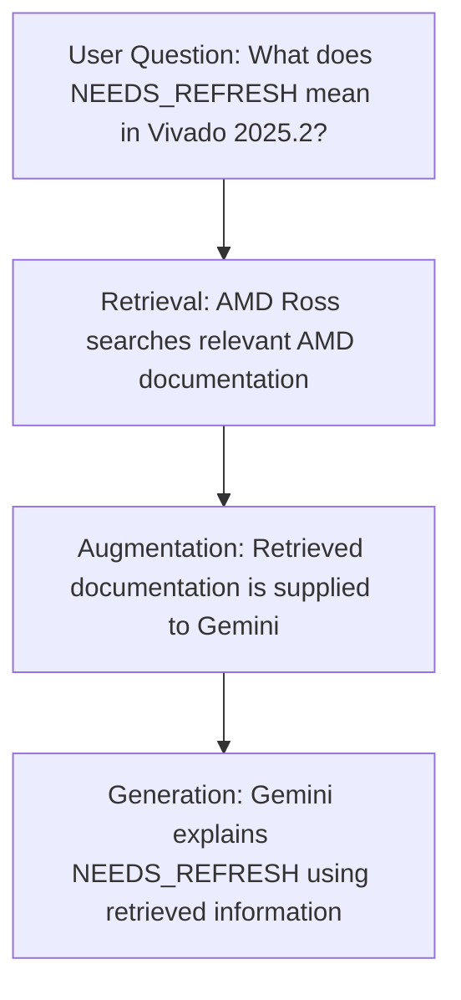

# MCP vs. RAG: Understanding the Difference

## 1. What Are MCP and RAG?

**MCP (Model Context Protocol)** defines how an AI application connects to external tools and data sources.

**RAG (Retrieval-Augmented Generation)** is a technique for retrieving relevant information from external knowledge sources and supplying it to a Large Language Model (LLM) before generating an answer.

**Key Difference:**
- **MCP:** Provides a standardized mechanism for connecting AI applications to external tools and data sources.
- **RAG:** Enables an LLM to generate answers using retrieved information.

## 2. Example: AMD Ross with Google Antigravity

In our Google Antigravity setup, we configured the following MCP server:

```json
{
  "mcpServers": {
    "amd-doc-search": {
      "serverUrl": "https://ross.amd.com/mcp/doc-search"
    }
  }
}
```

This configuration connects Gemini to the **AMD Ross documentation-search MCP server**, which exposes the `vivado_doc_search` tool.

The tool allows Gemini to search AMD technical documentation and retrieve relevant information, supporting a **RAG workflow**.

## 3. Why Is RAG Useful?

**Without RAG:**

An LLM primarily relies on its training knowledge and any context provided in the conversation.

**With RAG:**

An LLM can retrieve information from external sources, such as technical documentation, and use that information when generating an answer.

This provides several benefits:

- Access to more precise, domain-specific technical information.
- Ability to retrieve documentation that may be newer than the LLM's training knowledge.
- Reduced dependence on the LLM's internal knowledge when answering technical questions.

> **Important:** RAG does not retrain or modify the LLM. It supplies relevant information at the time a question is answered.

### RAG Workflow with AMD Ross

1. The user asks Gemini a question about Vivado.
2. Gemini invokes `vivado_doc_search` through the AMD Ross MCP server.
3. The tool retrieves relevant passages from AMD documentation.
4. Gemini uses the retrieved information as additional context.
5. Gemini generates an answer based on the available context.




## 4. Does Every MCP Server Provide RAG?

**No.** MCP servers can expose different capabilities, and not every MCP operation involves retrieval-augmented generation.

Consider these two MCP servers:

| MCP Server | Capability | RAG? |
|---|---|---|
| `amd-doc-search` | Searches AMD documentation and returns relevant information | Yes, when retrieved content is used to generate an answer |
| `vivado-mcp-server` | Executes supported Vivado operations and retrieves tool results | Not inherently |

### Example 1: Vivado Tool Execution (Not RAG)

Suppose Gemini invokes `report_utilization` through the Vivado MCP server.

The MCP server executes the Vivado command and returns utilization results.

This is **tool execution**, not RAG, because the operation does not inherently involve retrieving knowledge from an external documentation source to augment the LLM's answer.

### Example 2: AMD Documentation Search (RAG)

Suppose Gemini invokes `vivado_doc_search` to find information about Vivado timing constraints.

The AMD Ross MCP server retrieves relevant documentation, and Gemini uses that information to generate an answer.

This is a **RAG workflow** because external knowledge is retrieved and incorporated into the LLM's response.

## 5. Key Takeaway for Students

> **MCP is the communication mechanism; RAG is the knowledge-retrieval technique.**

An MCP server can expose RAG capabilities by connecting an AI application to a suitable retrieval system.

However, **MCP alone does not automatically provide RAG**. Whether an operation qualifies as RAG depends on how the retrieved information is used.

In our setup, **AMD Ross provides documentation retrieval through MCP**, allowing Gemini to use AMD technical documentation as an external knowledge source when generating answers.
